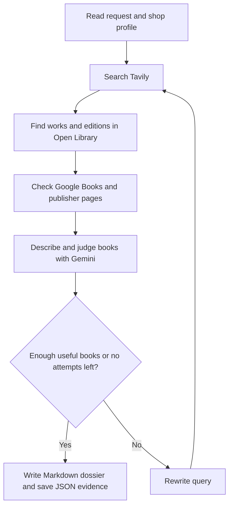

# Editorial Research Agent workflow

This Mermaid export summarises the workflow documented at commit `3939562`. [Source graph](https://github.com/jaimegmarquerie-ui/proyecto3-agente-editorial/blob/3939562dec432c07f804a5412cf4a8c02dfdccd3/editorial_agent/graph.py)

The workflow allows up to two search attempts. The source architecture also documents tool error routes to a dossier marked NOT FINAL.
